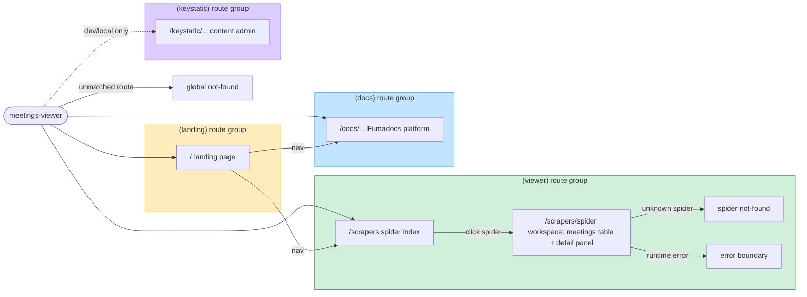

# App sitemap

Route map of the meetings-viewer Next.js app, grouped by layout. Route groups
from `app/`: `(landing)`, `(viewer)`, `(docs)`, `(keystatic)`. Source of truth
for the "meetings-viewer sitemap" diagram on the City Scrapers FigJam board.

