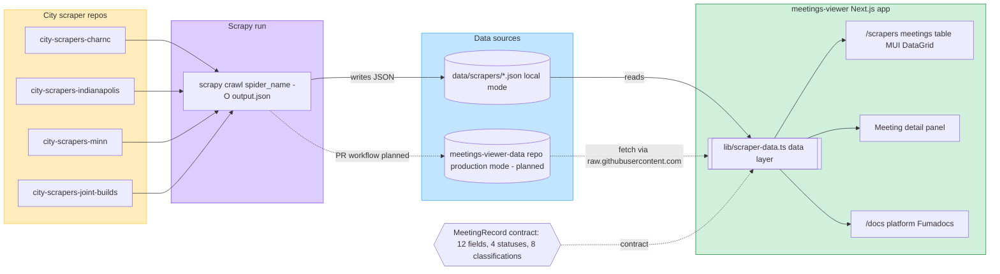

# Data pipeline

How city-scrapers repos feed meeting records into the meetings-viewer app.
Local mode today; production mode planned. Source of truth for the
"meetings-viewer data pipeline" diagram on the City Scrapers FigJam board.

Open questions tracked as stickies on the board (from
`content/docs/viewer/architecture.mdx`):

- Token mechanism for cross-repo writes: PAT or GitHub App?
- Concurrent workflow runs on the data repo: retry-with-rebase, a queue, or
  an accepted race?
- Is merged-PR data preserved, or deleted with unmerged-PR data?
- Periodic sweep for orphaned PR directories whose PRs no longer exist?
