# Docs platform automation flows

The four `docs:*` npm scripts and where they run. Each lane is one
automation in `docs-platform/engine/`; the last lane is the CI gate that
enforces it. Source of truth for the "docs platform automations" diagram
on the City Scrapers FigJam board.

```mermaid
flowchart LR
  subgraph sync["npm run docs:sync - engine/sync-sources.ts"]
    direction TB
    syncIn[("sources.json - one entry per mirror")]
    syncFetchable{"github.com blob URL?"}
    syncFetch["rewrite to raw.githubusercontent.com and fetch"]
    syncManual["manual - print origin to copy by hand"]
    syncDiff{"bytes differ?"}
    syncWrite["overwrite mirror file"]
    syncBump[("bump synced_at in sources.json")]
    syncIn --> syncFetchable
    syncFetchable -->|"yes"| syncFetch
    syncFetchable -->|"no"| syncManual
    syncFetch --> syncDiff
    syncDiff -->|"yes"| syncWrite
    syncDiff -->|"no"| syncBump
    syncWrite --> syncBump
  end

  subgraph drift["npm run docs:drift / docs:drift:check - engine/check.ts"]
    direction TB
    claims{{"drift/claims.ts - master source plus restatements per subject"}}
    extract[["engine/extract.ts - pull each side's asserted value"]]
    evaluate[["engine/evaluate.ts - compare, tag certain / likely / prompt"]]
    fresh["mirror freshness - synced_at + ttl_days"]
    mutes[("drift/mutes.json - suppress by fingerprint")]
    driftOut[("drift/findings.json + drift/report.md grouped by owner")]
    gate{"--fail and a blocking finding?"}
    driftFail["exit 1"]
    corpus["docs:drift:test - check.test.ts fixture corpus, recall and precision must be 1.0"]
    claims --> extract --> evaluate
    evaluate --> fresh --> mutes --> driftOut --> gate
    gate -->|"yes"| driftFail
    corpus -.->|"same evaluateClaims"| evaluate
  end

  subgraph schema["npm run docs:schema / docs:schema:check - engine/generate-schema.ts"]
    direction TB
    iface[["lib/scraper-data.ts - MeetingRecord interface"]]
    vocab[["constants.py mirror - STATUSES + CLASSIFICATIONS"]]
    build["parse fields, types, required - underscore-internal excluded"]
    schemaOut[("generated/meeting-schema.json")]
    stale{"--check: regenerated output differs?"}
    staleFail["exit 1 - schema stale"]
    rendered["SchemaTable on /docs/qa/schema"]
    iface --> build
    vocab --> build
    build --> schemaOut
    schemaOut --> stale
    stale -->|"yes"| staleFail
    schemaOut --> rendered
  end

  subgraph links["npm run docs:links - engine/check-links.ts"]
    direction TB
    walk["walk content/docs *.mdx plus README.md"]
    collect["collect markdown links and JSX hrefs"]
    resolve["resolve /docs page + heading anchor, app route regex, relative path"]
    ok{"all links resolve?"}
    linkFail["exit 1 - broken links listed"]
    ext["external URLs deferred to lychee"]
    walk --> collect --> resolve --> ok
    ok -->|"no"| linkFail
    resolve -.-> ext
  end

  subgraph ci["GitHub Actions gates"]
    direction TB
    ciDrift["docs-drift.yml - corpus test, docs:drift:check, committed findings must be fresh, artifact + PR comment"]
    ciBuild["docs-build.yml - next build, check-links, regenerate schema and diff"]
    ciLychee["docs-links-external.yml - weekly lychee, rollup issue on failures"]
  end

  syncBump -.->|"fresh mirrors - re-run docs:drift"| extract
  syncBump -.->|"ttl reset"| fresh
  rendered -.->|"page asserts generated output - schema-page-generated claim"| claims
  driftFail ==>|"fails PR check"| ciDrift
  staleFail ==>|"fails PR check"| ciBuild
  linkFail ==>|"fails PR check"| ciBuild
  ext -.->|"weekly schedule"| ciLychee

  style sync fill:#C2E5FF,stroke:#3DADFF
  style drift fill:#FFECBD,stroke:#FFC943
  style schema fill:#D0F0DB,stroke:#198038
  style links fill:#DCCCFF,stroke:#874FFF
  style ci fill:#F5F5F5,stroke:#8D8D8D
```

Notes for the board:

- `docs:drift` report mode always exits 0; only `--fail` (`docs:drift:check`)
  exits 1, and only on `certain` findings while `BLOCKING_GATE_ENABLED` is set
  in `engine/evaluate.ts`.
- `docs:sync` only auto-fetches GitHub blob URLs; Google Docs and other
  origins print "manual" with the origin to copy from.
- `docs:links` checks internal links only; outbound URLs are
  `docs-links-external.yml`'s weekly lychee job.
