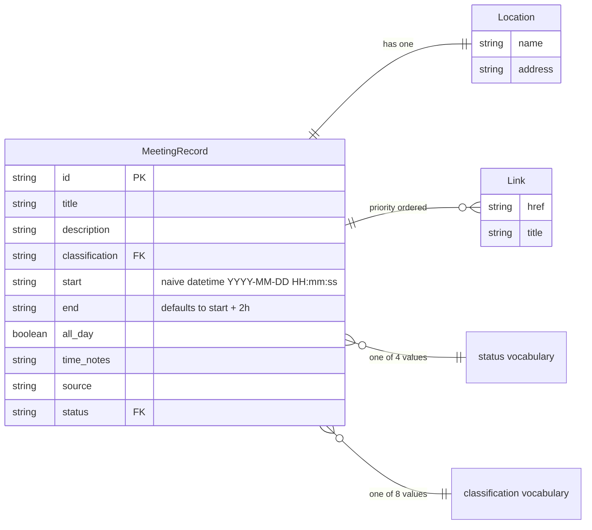

# MeetingRecord schema

ER view of the `MeetingRecord` contract from `lib/scraper-data.ts` plus the
status/classification vocabularies from `docs-platform/generated/
meeting-schema.json`. Regenerate the vocabularies with `npm run docs:schema`.

Status values: `cancelled`, `tentative`, `confirmed`, `passed`.

Classification values: Advisory Committee, Board, City Council, Commission,
Committee, Forum, Police Beat, Not classified.
