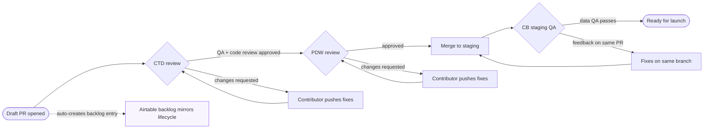

# Scraper PR lifecycle

The multi-phase PR lifecycle for a scraper, from draft to launch. Mirrors
`content/docs/qa/review-process.mdx` and the Airtable tracking described in
`content/docs/pipeline/airtable-sync.mdx`.

