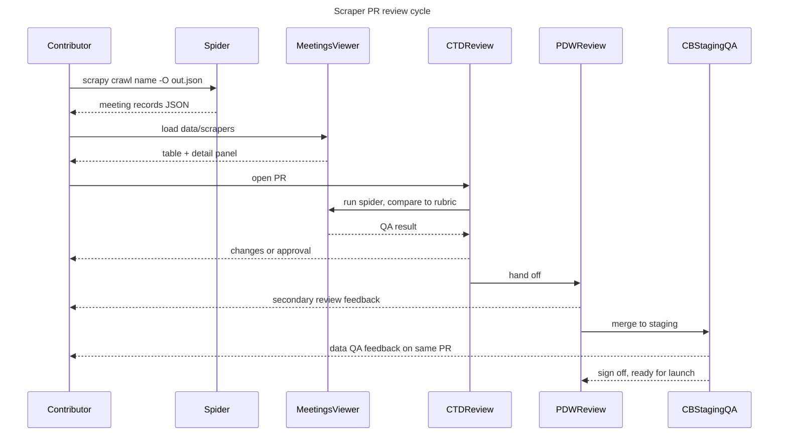

# Scraper PR review cycle

Sequence view of the QA loop a scraper PR goes through: local run, viewer
check, then the three review phases from
`content/docs/qa/review-process.mdx` (CTD review, PDW review, CB staging QA).

