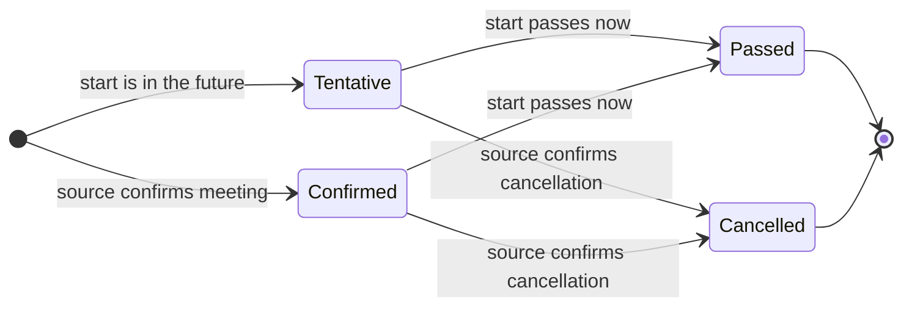

# Meeting status lifecycle

The four `status` values a meeting record can carry and how a record moves
between them. Derivation lives in the base spider's `_get_status`; see
`content/docs/qa/schema.mdx`.

